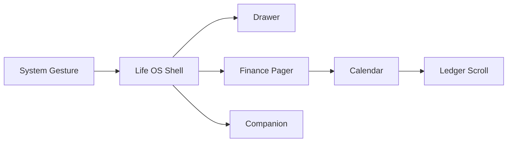

# 对这份 Deep Research 的复审结论

## Executive Summary

这份 Deep Research **整体质量很高，值得作为 V16 决策的核心输入，但我不建议直接把它当成 V16 最终规格交给 Codex 开工。**

我给它的评价大约是：

| 维度 | 评价 |
|---|---|
| 当前代码状态理解 | **很强** |
| 真机反馈归因 | **很强** |
| Finance 语义理解 | **很强** |
| Gesture / Android 平台边界 | **强** |
| Evidence / Accessibility / Privacy | **很强** |
| 外部产品研究 | **强** |
| 防止过度设计 | **很强** |
| 产品优先级 | **强** |
| 三套完整 V16 架构对比 | **不够完整** |
| 六个月路线图 | **明显没有按你的原要求完成** |
| Mermaid 架构图 | **缺失** |
| 可量化验收指标 | **不够** |
| 篇幅控制 | **严重超出原要求** |

最重要的是，它得出了一个我基本赞同的总判断：

> **V16 不应该继续以“把 V15 R2 所有红点逐个修掉”为主线，而应该先把 Life OS 的“账本任务流、页面状态边界、手势所有权、余额可信度、自动发现可解释性”重新收口。**

主报告的核心优先级是“记得快、补得顺、核得清、关系看得懂”，并建议先解决快速录入、账簿主入口、逐笔余额、往来工作页、自动发现的诊断/绑定/去重，而不是继续扩 Provider 或堆统计模块。fileciteturn0file3

这个方向我认为是对的。

而且我刚刚又直接核了 GitHub：Deep Research 固定的 R2 基线没有过期。当前 `feature/life-os-v15-ui-convergence-p1-r2-final` 仍指向 `245e1475cd1d47a4205ab49f75d5e06d22de701c`，最后提交就是 `fix(android): converge R2 finance tests with reviewed semantics`。fileciteturn3file0L1-L10 对应 Android CI #50 也确实是这个 SHA，并且结果为 `success`。fileciteturn4file0L1-L10 文档分支也仍停在报告写的 `952d8e53...`。fileciteturn6file0L1-L10

所以这不是一份建立在旧代码上的空泛研究。

## 这份研究真正做得好的地方

### 它没有被你的五十二页反馈牵着逐条打补丁

这是最重要的一点。

你的真机报告里其实有大量表面上互不相关的问题：冷启动白屏、Finance 进页面卡、四页横滑和 Drawer 冲突、Companion 难滑出来、抽屉字体和 blur 不对、Finance 顶部密度差、账户一行一个、记账录入慢、月历停半截、Accessibility 没反应、通知监听失联等。fileciteturn0file4

Deep Research 没有把这些翻译成：

```text
改搜索框
改账户卡片
加一个动画
扩大手势范围
修一个 Accessibility
```

而是抽成五个根因：

> 空间规则没有成为状态契约；视觉组件复用了但信息层级没有；Finance 语义分层已经存在但 UI 没表达出来；状态影响范围过宽；系统能力被一个简单开关掩盖。

这个归因非常重要。fileciteturn0file3

特别是 Gesture，它推荐的不是“做一个超级根节点手势识别器”，而是：

> **统一所有权规则，但让局部组件执行。**

也就是 Drawer、Pager、月历、列表、Companion 各自仍使用适合自己的高层组件，只共享一份“谁在什么区域、什么状态下拥有这次手势”的契约。

这个方案比我们之前不断加 edge corridor、Initial pass、特殊 if 的方向健康得多。

### Finance Core 没有被为了 UI 重写

这是我非常认可的地方。

报告明确建议继续保留：

```text
真实账户资金流
个人消费
事项/往来
Expected Flow
Proposal
Canonical Truth
```

这些层之间的区别；也明确反对因为 UI 更方便就重新造数据库、造第二套账本、把退款改小原支出、把报销回款伪造成收入。fileciteturn0file3

这一点与我们之前费了很多轮才守住的 Finance 红线完全一致。

特别是 running balance，它没有建议：

```text
transaction.runningBalance = ...
```

永久写死每行余额。

而是明确提出：

> `起点余额 + 截至该笔的所有有效账户资金流`

是投影；补录旧账后重新计算受影响后缀。Observation 用于核对，Checkpoint 只是可重建缓存，不是真相。fileciteturn0file3

这个结论是非常成熟的。

它还准确指出一个容易犯错的情况：

> 如果 10 月 1 日用户确认余额为 2000，而以后补录一笔 9 月交易，就不能再次从这 2000 中扣，因为这笔 9 月交易可能已经包含在当时实际余额里。

这说明研究不是只会说“running balance = prefix sum”，它理解了 anchor 的语义边界。

### 自动发现终于从“多写 Adapter”转向“可信证据”

这个也是很大的进步。

报告没有继续把重点放在：

```text
再支持哪个 App？
```

而是转成：

```text
为什么没识别？
识别到的是什么？
支付工具是谁？
真实 Finance Account 是谁？
这两个来源是不是同一笔？
用户凭什么相信这个结果？
```

它把：

```text
Provider
Source Family
External Account
Payment Instrument
Finance Account
```

拆成五个不同概念。fileciteturn0file3

这个比我们之前四层 Host / Source / Channel / Account 还往前走了一步：它补出了 `External Account`，这对以后一个人多个支付宝身份、多张同尾号卡、历史换卡等情况是必要的。

Evidence 方向也比较克制：

> 稳定交易 ID 可以强关联；仅仅金额相同 + 时间接近 + 商户类似只能提示“可能同笔”，不能自动合并。

我完全同意。

### 隐私意识比普通技术方案高一个档

报告没有走：

```text
既然 Accessibility 能看到，就把整页存起来以后慢慢解析
```

这种危险路线。

它继续坚持：

> 最小结构化 Evidence；原始截图、通知全文、节点树不长期保存；哈希也不能自动当匿名化。

还专门提醒银行卡尾号之类低熵值数据即使哈希也有枚举风险。fileciteturn0file3

候选清单里同样把 OCR 定义为“用户主动选图 → Candidate”，而不是后台全屏抓取。fileciteturn0file1

这一点非常符合你现在“截图绝不上传 GitHub”的隐私方向。

## 我认为最值得采纳的架构结论

有几项我会直接升级成 V16 的设计原则。

### Gesture 选 B

报告给的是：

```text
A 每页继续补判断
B 区域与能力契约 + 局部组件执行
C 根节点万能手势引擎
```

我明确选 **B**。

C 看起来“统一”，实际上极容易与：

- Compose Pager
- nested scroll
- TextField
- Selection
- BottomSheet
- Predictive Back
- TalkBack
- 系统导航手势

打架。

B 才是 Life OS 这种手势很多的 App 长期能维护的方案。

建议 V16 把一个手势生命周期定义清楚：

```text
触点进入
↓
确定候选 owner
↓
超过 touch slop
↓
锁定 axis
↓
owner 固定到本次手势结束
↓
消费/传递剩余 delta
↓
settle / cancel
```

而不是拖到一半换所有者。

### Finance IA 我也倾向 B

报告给：

```text
A 总览 / 流水 / 账户 / 分析
B 账簿 / 账户 / 分析，往来成为工作页
C 万能单页账簿
```

我认为 **B 最符合你现在的真实使用需求**。

因为你的五十二页反馈反复表达的其实不是“总览不好看”，而是：

> **我想快点看到账、补账、找账、核账。**

现在“总览”和“流水”很容易重复表达同一批信息。

更合理的结构是：

```text
账簿
├─ 最近发生
├─ 月历/日期
├─ 搜索
├─ 收支轻摘要
├─ 待确认
└─ 最近流水

账户
├─ 余额
├─ 账户账簿
├─ running balance
└─ reconciliation

分析
├─ 日期范围
├─ 账户
├─ 分类
├─ 事项
└─ drill-down

往来 / 报销 / 代付
└─ Task workspace
```

这比四个对等 Tab 更接近你日常真正做的任务。

但这一点我建议最终让 Astra 再挑战一次，因为 Figma 当前 Finance 明确还是四 Tab；我刚刚也实际复核了 `F01 · Finance · 总览` 节点，确实仍然设计成总览/流水/账户/分析四入口。Deep Research 这里是在**有意识地提出推翻现有 IA**，不是简单复述 Figma。fileciteturn0file0

这需要 Owner 最终拍板。

### Running Balance：先 A，再有证据才上 B

报告推荐：

```text
A 实时按账户账簿计算
B checkpoint / prefix cache
C 永久写每笔余额 / 全面 event sourcing
```

我也选：

> **A → profile → 必要时 B。**

绝对不要为了“以后可能有 5 万笔账”现在就先构造复杂 checkpoint invalidation。

你现在历史数据大概几千笔级，先保证语义正确再测。

### Account Identity 选“小模型”，不要知识图谱

报告的 B：

> External identity + Payment instrument + explicit binding + scope/effective period

我赞成。

但不要一次性做到：

```text
支付宝身份
银行卡身份
淘宝身份
银行账户
卡片
钱包
账户
Person
Institution
Provider
Source
...
```

十几个 Entity。

先解决最实际的：

```text
这个来源告诉我：
“建设银行储蓄卡 ****4665”

你确认：
它对应 Life OS Account X

以后相同来源范围内：
优先建议 X
```

并允许解绑/换卡/过期。

够了。

### 小票一定 A 为基线，B 是增强

这一点 Deep Research 判断得很准确。

目前已有跨 App `TYPE_APPLICATION_OVERLAY`，但因为 `FLAG_NOT_FOCUSABLE`，它天然无法直接完成正常键盘编辑。fileciteturn0file3

因此：

```text
A App 内 Sheet / 通知打开统一 Receipt
= 必须可靠

B 可编辑跨 App Overlay
= 值得做，但单独验收

C vivo 原子岛
= 探索
```

这比我们直接奔着“原子岛”务实很多。

尤其报告明确说：

> Bubbles 和 Live Updates 都不是拿来伪装支付后记账弹窗的。

这个判断我赞同。

## 这份报告没有完成你原任务的地方

这里有几个很明确的缺口，我建议不要忽略。

### 最大缺口：没有给出“三套完整 V16 Architecture”

你原指令要的是：

> **3 candidate V16 architectures (A/B/C)**，并且 Navigation/Gesture、Finance IA/Truth、Evidence、Running Balance、Account identity、Atomic receipt 都要在每套方案里整体比较。

这份报告实际上做的是：

```text
Gesture A/B/C

Finance IA A/B/C

Running Balance A/B/C

Identity A/B/C

Evidence A/B/C

Receipt A/B/C
```

也就是**每个子系统分别给三个方案**。

这当然有价值，但它没有回答一个更高层的问题：

> 如果我们选择保守型 V16，它整套是什么样？
>
> 如果我们选择平衡型 V16，它整套是什么样？
>
> 如果我们选择激进重构型 V16，它整套又是什么样？

所以 Astra 很适合补这一层。

我会要求 Astra 最终给：

| 整体方案 | 核心 |
|---|---|
| **V16-A Conservative** | 保留四 Finance 页、Room v4、现有 Proposal，只修体验与可靠性 |
| **V16-B Balanced** | 三页 Finance + Gesture Contract + Running Balance + Relations + 小型 Identity/Evidence |
| **V16-C Structural** | 更彻底 Query/Command 分离 + 新 Evidence/Identity/Reconciliation persistent model + 可编辑 Overlay |

然后我们比较**整个方案包**，而不是逐项挑。

我目前预判最后大概率还是选 **B**。

### 你明确要求的 Mermaid 图没有做

我搜索了整个主报告，没有 Mermaid block。

但你原来明确要求：

- navigation/gesture ownership diagram
- evidence flow diagram

这不是装饰。

这两个地方恰恰最适合图示。

至少应该有：



以及：


并把**失败/冲突路径**画出来。

这会大幅降低后续 Codex 对架构的误读。

### “未来六个月”没有完成

这是这份报告最明显的不服从原任务之一。

你原文明确要求：

> concrete implementation roadmap for next 6 months with milestones

但报告最后反而写：

> “不建议给这些阶段编造精确工期。”

fileciteturn0file3

这里我认为它谨慎过头了。

你并没有要求它承诺：

```text
11 月 7 日一定上线
```

你要求的是**规划框架**。

完全可以给：

```text
第 1 月
V16-A UX / gesture / quick entry

第 2 月
Ledger + running balance

第 3 月
Reconciliation + relations

第 4 月
Evidence diagnostics + identity foundation

第 5 月
Evidence correlation + receipt

第 6 月
performance / privacy / migration hardening
```

并注明：

> 日历时间仅作为规划窗口，实际推进按 Gate，不是交付承诺。

这不会“编造工期”。

所以这部分建议让 Astra 补齐。

### 可量化 Acceptance Criteria 不足

报告有“真实任务验收”，这是好的，比如：

> 连录十笔、跨日补一周、补一笔上月漏账、两张同尾号卡不误合并。

fileciteturn0file3

但还不够可测。

V16 最终应该有类似：

```text
手工记账：
普通支出从打开编辑器到保存，
不超过 1 个主页面 + 2 次必要选择。

连续补账：
10 笔无需每笔重选固定账户/月。

月历：
不存在稳定停留在半折叠状态。

Gesture：
在 Finance page 2–4 主体右滑不会打开 Drawer；
在定义的 Shell 通道可以打开。

Running Balance：
补录历史交易后，
所有后续账户逐笔余额 deterministic 更新。

Accessibility：
失败必须落入一个可解释 reason code；
不能只表现为“没反应”。

Privacy：
测试日志、数据库、diagnostic buffer
不得含手机号/完整地址/完整节点树。
```

性能部分则应该等 trace 基线后定：

```text
P50 / P95
frame time
time-to-first-draw
time-to-interactive
Finance first-open
import 4548 rows
```

报告正确地没有虚构 FPS，但下一阶段必须把**测量方法**和**达标 Gate**写出来。

### 篇幅已经远远不是“max 2500 words”

主报告大约 5 万字符，另外还有 64 项功能清单和证据索引。

作为研究资料这是优势。

作为“决策报告”则太长。

实际上它已经形成了很合理的三层：

1. `阅读入口.md`
2. `V15-R2到V16架构与产品决策报告.md`
3. `案例与证据索引.md`
4. `记账功能候选清单.md`

fileciteturn0file2

我建议保留这些长材料，但**另外需要一份真正给 Owner 拍板的 5～8 页 Decision Memo**。

否则下一步很容易变成：

> 看了很多，最后不知道到底批准什么。

## 我建议现在怎么把它交给 Astra

我不建议让 Astra 重新研究一遍这 13 个产品。

Deep Research 的案例库已经够好了：Actual、Firefly III、GnuCash、Beancount、Money Manager、YNAB、Monarch、Ivy、Cashew、Lunch Money、Expensify、Splitwise、Monzo，而且证据索引清楚地区分了“值得借鉴”和“不应照搬”。fileciteturn0file0

64 项候选功能也不要让 Astra重新发散。这个清单适合作为**产品 backlog 池**，不是 V16 Scope。fileciteturn0file1

我建议 Astra 的任务现在缩成：

> **批判 Deep Research、结合它自己的代码阅读，做最终 Architecture Decision。**

你可以把这段追加给 Astra：

```text
你现在已经获得 OpenAI Deep Research 的四份材料：

1. 阅读入口.md
2. V15-R2到V16架构与产品决策报告.md
3. 案例与证据索引.md
4. 记账功能候选清单.md

不要重新做一遍相同的外部产品研究。

请把 Deep Research 视为一名独立高级架构师提交的研究意见，
不是权威答案。

你的任务是：

REVIEW IT.
CHALLENGE IT.
MERGE IT WITH YOUR OWN CODE ANALYSIS.
THEN MAKE THE FINAL V16 ARCHITECTURE RECOMMENDATION.

重点补足 Deep Research 当前没有完整完成的四件事：

A. 三套“整体 V16”候选架构，而不是每个子系统各自 A/B/C。

必须给：

V16-A Conservative
V16-B Balanced
V16-C Structural

每套都同时定义：

- Navigation
- Gesture ownership
- Home / Drawer
- Finance information architecture
- Finance Commands / Queries
- Running Balance
- Reconciliation
- Relations / reimbursement
- Account Identity
- Evidence / Proposal
- Accessibility
- Receipt / Overlay
- Room migration boundary
- Privacy model
- Performance implications

然后横向比较。

B. 给出明确推荐方案。

不要回答“各有优缺点”。

必须选一个作为 Recommended V16，
并说明为什么不是另外两个。

C. 给出六个月规划窗口。

不是承诺日期，而是 Planning Horizon。

按 Month 1–6 给：

- scope
- exit gate
- device validation
- architecture validation
- privacy validation
- what is explicitly deferred

D. 给出可量化 Acceptance Criteria。

不要虚构尚未测得的 FPS 基线。

对于还没有 baseline 的性能指标：

先定义 measurement protocol，
Month 1 建立 baseline，
然后再定义 relative / absolute gate。

另外必须补两个 Mermaid：

1. Navigation / Gesture Ownership
2. Evidence → Proposal → Receipt → Truth

最终输出不要再列 64 个功能。

把结果压缩成：

《Life OS V16 Architecture Decision Memo》

目标是让我作为 Owner 可以直接回答：

APPROVE V16-A
APPROVE V16-B
APPROVE V16-C
或者
REQUEST CHANGES

不要写代码。
不要生成 Codex Task。
不要提交 patch。
```

我认为现在最好的组合其实已经很清楚了：

> **Deep Research 负责“广度、外部证据、产品案例、方案空间”；Astra XHigh 负责“项目内部推理、架构取舍、批判和最终收敛”。**

这份 Deep Research **不用重做**。

它已经足够好，下一步应该是**压缩、对抗、拍板**，而不是再研究更多功能。

我的当前倾向也很明确：最终 V16 很可能应该落在它隐含的 **Balanced 路线**——保留现有 Truth Core，重构 Gesture/Query/UI task flow；先用现有 v4 实现快速录入、账簿、running balance 和往来，再以**一个小而明确的 migration**加入 Identity / Evidence / Reconciliation，而不是把 64 项功能和 Room v5 一次塞进 V16。fileciteturn0file3